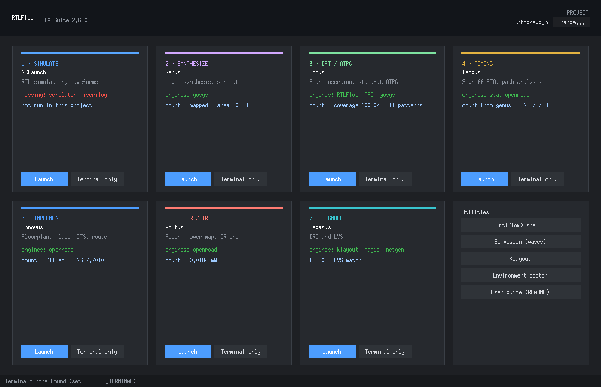
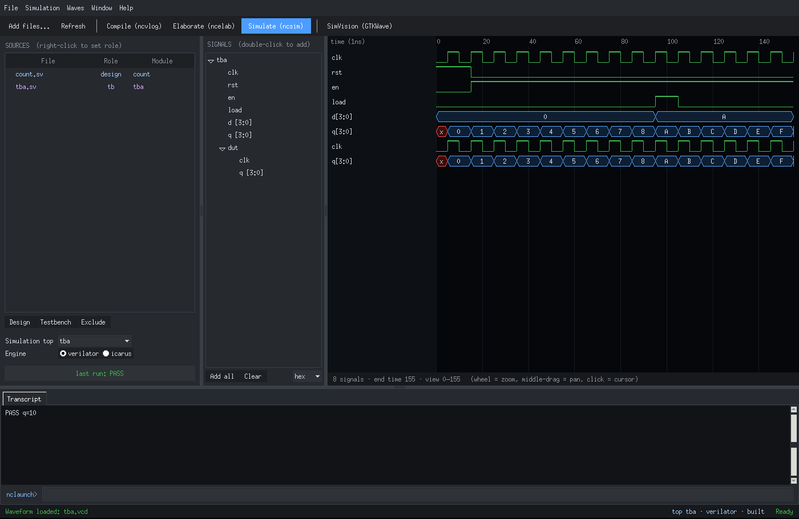
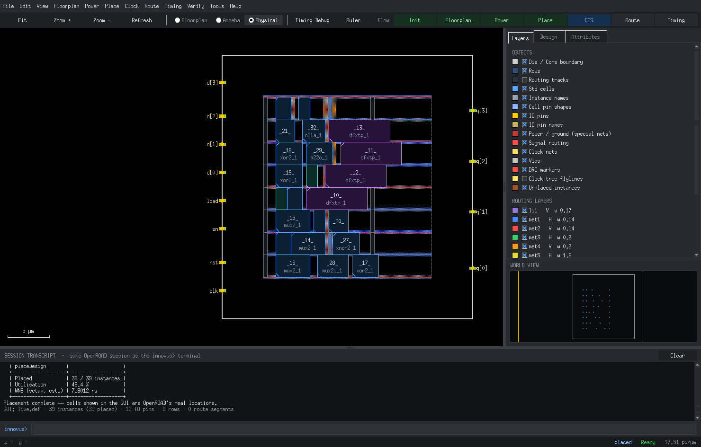
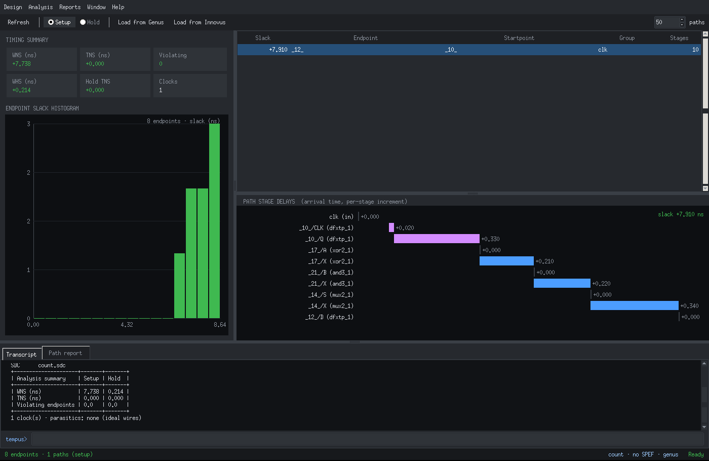
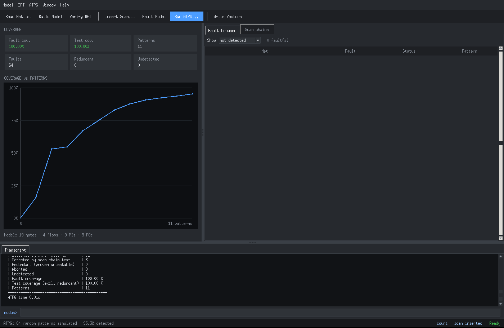
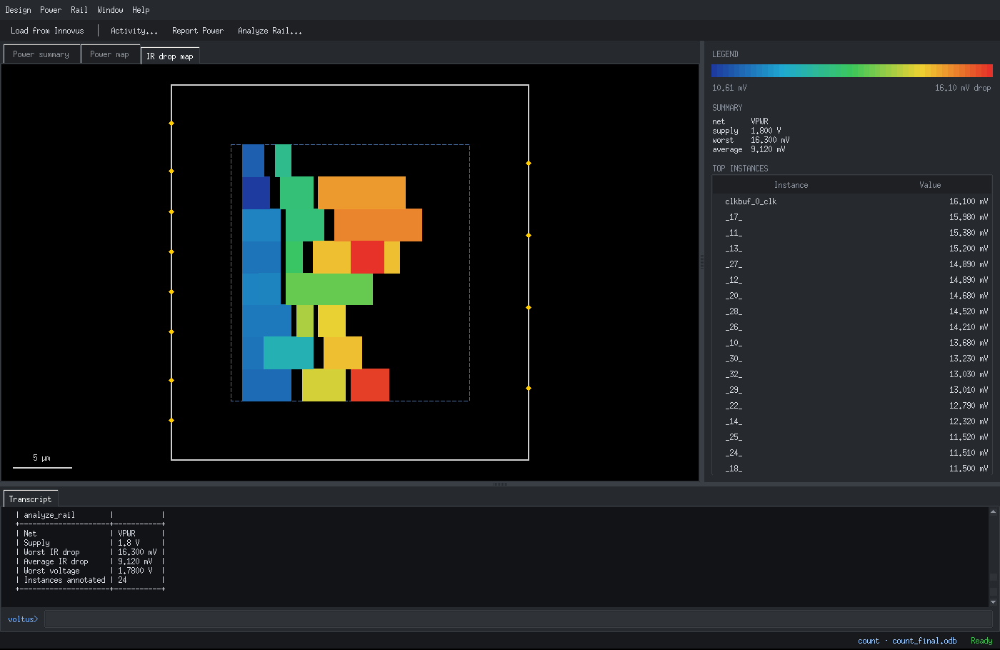
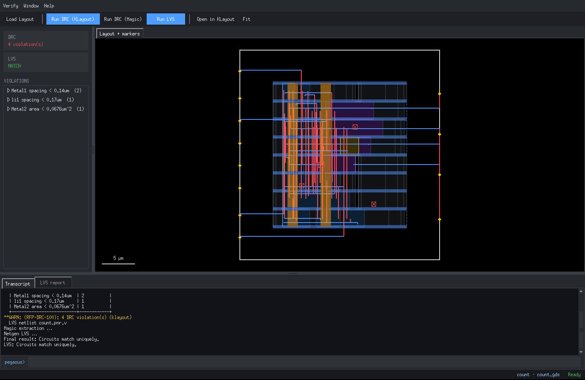

# RTLFlow 2.7.0 "Signoff"

A Cadence-style EDA suite — seven tools, each with a Tcl-style shell **and** its
own GUI on the same session — running real open-source engines underneath.

| Tool | Stage | Engine underneath | GUI |
|---|---|---|---|
| `nclaunch` | Simulation | Verilator / Icarus | source manager, compile/elab/sim, built-in waveform viewer |
| `genus` | Synthesis | Yosys (+ABC), OpenSTA | schematic of the mapped netlist, reports |
| `modus` | DFT / ATPG | RTLFlow ATPG engine (scan insertion, bit-parallel fault sim, PODEM) | coverage curve, fault browser, scan chains |
| `tempus` | Signoff timing | OpenSTA (persistent session) | slack histogram, path browser, stage-delay view |
| `innovus` | Implementation | OpenROAD (one persistent session) | live layout from the OpenROAD DB, timing debug |
| `voltus` | Power / IR | OpenSTA power, OpenROAD PDNSim | power breakdown, power map, IR-drop map |
| `pegasus` | Physical verification | KLayout / Magic DRC, Magic + Netgen LVS | violation browser with markers on the layout, LVS result |

No `nix-shell`: `rtlflow/env.py` finds every tool on PATH, in `/nix/store`
(OpenLane2) or common locations, and the PDK in `~/.volare`.



| | |
|---|---|
|  |  |
|  |  |
|  |  |

*Screens rendered from the test fixtures (mock engines); on a real install they show your OpenROAD/OpenSTA data.*

## Install

```bash
cd ~/VLSI
mv rtlflow2 rtlflow2-2.6.0.bak
git clone <this repo> rtlflow2        # or unzip the release zip
~/VLSI/rtlflow2/install.sh --cadence-names
hash -r
```

`install.sh` links `rtlflow` (and with `--cadence-names` every tool name) into
`~/.local/bin`, adds an **RTLFlow EDA Suite** entry to the GNOME app grid, checks
Tk and runs tool discovery. GUIs need `sudo apt install python3-tk`.

## Choosing what to run

* **Launcher window:** `rtlflow -gui`, `rtlflow> gui`, or the app-grid icon. One
  card per tool: **Launch** opens the tool's shell in a new terminal with its GUI
  attached; **Terminal only** opens just the shell. Cards show engine status and
  what the project has done so far.
* **From the rtlflow> prompt:** `nclaunch -gui`, `genus -gui`, `modus -gui`,
  `tempus -gui`, `innovus` (GUI by default, `-nowin` for none), `voltus -gui`,
  `pegasus -gui`.
* **Inside any tool:** `gui_show` opens its GUI later, `gui_hide` closes it; the
  session keeps running.

Every GUI action is sent back to its shell as an ordinary command, echoed as
`[GUI] …` in the terminal and recorded in `.rtlflow/logs/<tool>.cmdN`.

## Full flow (exp_5 / count)

```
cd ~/Desktop/SYSTEM_VERILOG/LAB/exp_5
rtlflow -gui                                  # or type the tools below at rtlflow>

nclaunch -gui   : read_hdl -sv count.sv ; read_tb tba.sv ; elaborate tba ; simulate
genus -gui      : source ~/VLSI/rtlflow2/scripts/genus_count.tcl        (ends with write_design -innovus)
modus -gui      : read_netlist ; build_model ; connect_scan_chains ; build_faultmodel ; create_logic_tests
tempus -gui     : read_design -from genus ; report_analysis_summary ; report_timing
innovus         : source .rtlflow/handoff/count.invs_flow.tcl ; streamOut count.gds
tempus -gui     : read_design -from innovus                       (post-route netlist + SPEF)
voltus -gui     : read_design -from innovus ; report_power -instances ; analyze_rail -net VPWR -voltage 1.8
pegasus -gui    : read_layout ; run_drc ; run_lvs
```

## Honest notes

* **modus** has no open-source Modus behind it — the ATPG engine is RTLFlow's own
  (liberty-function gate model, full-scan stuck-at, random bit-parallel fault
  simulation + PODEM with redundancy proof). It is exact for small/medium blocks;
  very large netlists will be slow in pure Python.
* **voltus** IR drop needs a power grid (innovus `globalNetConnect` + `sroute`)
  saved in the checkpoint; per-instance power needs an OpenSTA with
  `report_power -instances`.
* **pegasus** uses the PDK's decks (`libs.tech/klayout/drc`, `libs.tech/magic`,
  `libs.tech/netgen`) and needs a GDS from innovus `streamOut`.

## Files

```
<project>/.rtlflow/
    logs/        <tool>.logN / <tool>.cmdN / <tool>_gui.log
    runs/sim     simulation builds + waves
    runs/synth   checkpoints, <top>_mapped.v, <top>.mapped.json, <top>_scan.v
    runs/dft     ATPG model, patterns (<top>.pat)
    runs/sta     tempus outputs
    runs/pnr     live.def, reports, dbs/*.odb + *.def, <top>.pnr.v, <top>.gds
    runs/power   voltus reports, voltage maps
    runs/signoff DRC (.lyrdb), LVS reports
    handoff/     genus → innovus setup + reference flow
```

Full user guide: `docs/RTLFlow_User_Guide.docx`.

## Tests without EDA tools

`tests/mock_*.py` speak the same protocols as OpenROAD/OpenSTA, Yosys, KLayout,
Magic and Netgen with canned data, so every shell and GUI can be exercised on a
machine without those tools (development only), e.g.
`RTLFLOW_OPENROAD=$PWD/tests/mock_openroad.py bin/innovus`.
